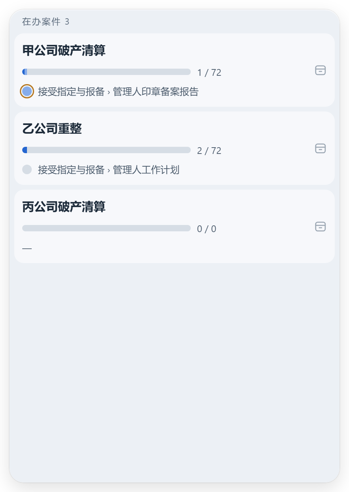
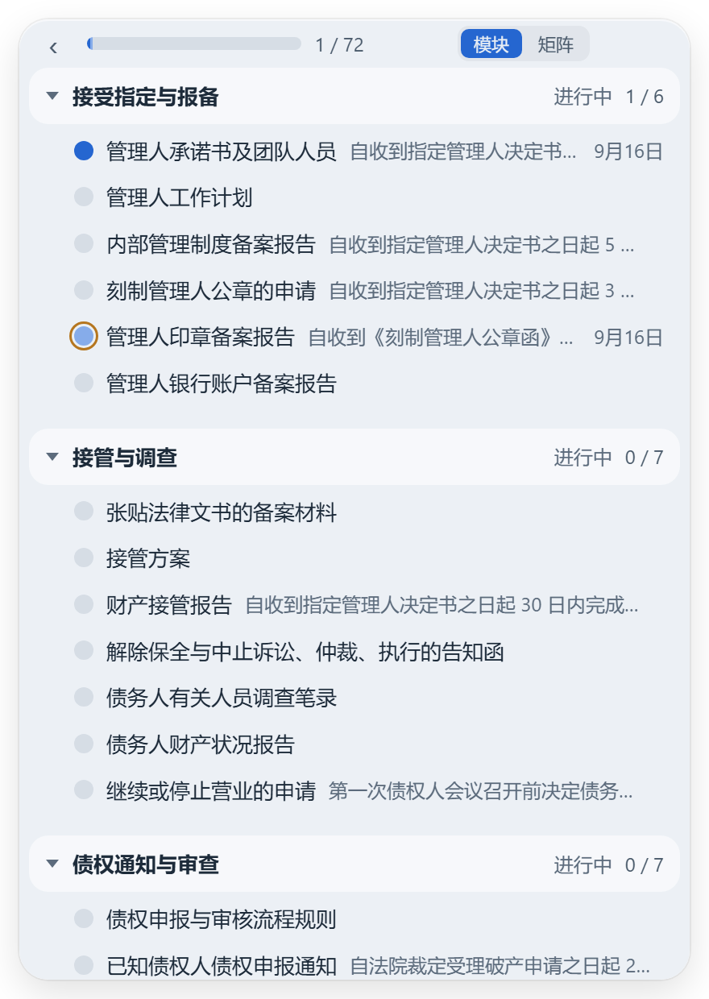
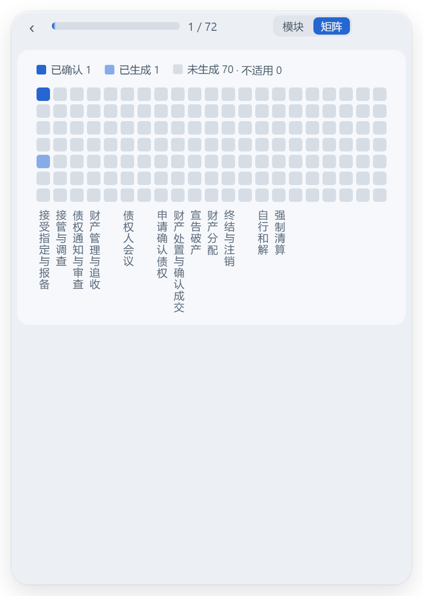

# loo0ng-widget

[English](./README.en.md)

常驻桌面的一张卡片，同时看住在办的多个案件：每案走到哪个模块、办到几分之几、下一个要办的节点是什么。

它配合 [loo0ng-skills](https://github.com/f4de01/loo0ng-skills) 使用：每个案件是本机上的一个工作区，卡片只读工作区里由图引擎算好的 `图视图.json`，一个字节都不写。它是 [Zebar](https://github.com/glzr-io/zebar) 的一个组件包，不是独立应用。

<p align="center">
  
  
  
</p>

清单页一案一行：目录名、进度条与「已确认 / 总数」、当前模块与当前节点，等你看的节点带一圈琥珀色。点一案进案件页：模块视按模块列节点，矩阵视一格一节点、一列一模块，一眼扫完整案。截图里是合成案件。

## 安装

先装好两样东西：

- [Zebar](https://github.com/glzr-io/zebar/releases)，卡片的宿主，装完不用打开。
- Python 3.9 以上。mac 自带；Windows 到 [python.org](https://www.python.org/downloads/) 装，安装时勾上 **Add python.exe to PATH**。

然后粘贴一条命令。它会下载组件包、问你案件放在哪个文件夹、把 Zebar 设成登录只开这张卡片，最后把卡片打开。安装时需要联网，运行时不需要。

Windows：打开 **PowerShell**，整行粘贴：

```powershell
irm https://raw.githubusercontent.com/f4de01/loo0ng-widget/main/install.ps1 | iex
```

mac：打开**终端**，整行粘贴（此命令尚未在 mac 实机验收）：

```sh
curl -fsSL https://raw.githubusercontent.com/f4de01/loo0ng-widget/main/install.sh | sh
```

它会问你：

- **案件根目录**：你的案件都放在哪个文件夹下面，每个案件是它下面的一个子文件夹。可以填多个，空行结束。答案写进 `~/.loo0ng/卡片设置.json`，以后要改就改这个文件，内容形如 `{"根目录": ["D:/案件"]}`。
- **要不要桌面快捷方式**「打开案件卡片」：关掉卡片后双击它就回来。
- Zebar 正在运行时，会先问你退出它，装完自动打开。

Zebar 在这里只是宿主：安装会把它的启动项整个改成只有案件卡片，Zebar 自带的那条顶栏（日期、CPU、电量）不再出现。

## 日常

- 卡片随登录出现在屏幕右上，可以拖到任何位置，位置记得住。
- 关了想再开：双击桌面的「打开案件卡片」，或对 agent 说一句「跑一下 `python ~/.glzr/zebar/loo0ng/launch.py`，把案件卡片打开」（mac 用 `python3`）。最小化了从任务栏或程序坞还原。
- 办完的案件：点清单页那一行右侧的归档图标收起；清单页末尾「已归档 N」里随时恢复。
- 根目录没填好时，卡片上只显示设置文件的路径和填写示例，修好后几秒内自动恢复。

## 更新

重跑上面那条安装命令。设置文件、窗口位置、停在哪一页、已归档的案件都留着。各版说明见 [Releases](https://github.com/f4de01/loo0ng-widget/releases)。

## 它读什么、不读什么

只读每个案件工作区里的 `图视图.json`。`材料/`、`文书/`、`待归档/`、`参考/` 一律不读、不列、不显示。卡片只显示引擎算好的结果，不自己判定。

这个仓库永不包含任何真实案件材料：测试用手写的合成视图，截图与验收用 loo0ng-skills 回放出的合成工作区，当事人写甲乙丙。

开发、测试与验收记录见 [docs/development.md](docs/development.md)。
